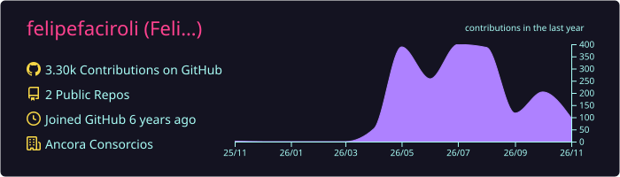
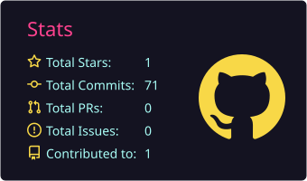
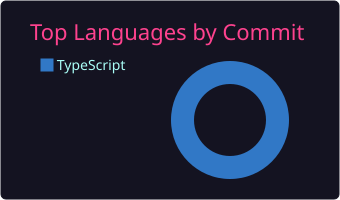
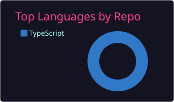
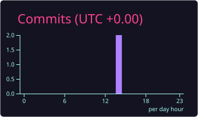

<h1 align="center">Hi, I'm Felipe Faciroli 👋</h1>
<h3 align="center">React & NestJS developer, and a gamer in my spare time</h3>

  

## 🛠️ Stack 

  

## 📊 GitHub Stats

  

  
  

  
  

  

## ☕ Social

  
  
  

2. Action que gera os indicadores

No repositório felipefaciroli/felipefaciroli, crie o arquivo .github/workflows/profile-cards.yml:

name: Profile summary cards

on:
  schedule:
    - cron: "0 3 * * *"
  workflow_dispatch:

permissions:
  contents: write

jobs:
  build:
    runs-on: ubuntu-latest
    steps:
      - uses: vn7n24fzkq/github-profile-summary-cards@release
        env:
          GITHUB_TOKEN: ${{ secrets.GITHUB_TOKEN }}
        with:
          USERNAME: ${{ github.repository_owner }}
