<h1 align="center">Olá, eu sou o Felipe Faciroli 👋</h1>
<h3 align="center">Dev React e NestJS, e gamer nas horas vagas</h3>

  

## 🛠️ Tecnologias 

  

## 📊 Estatísticas no GitHub

  

  
  

  
  

  

## ☕ Contato

  
  
  

